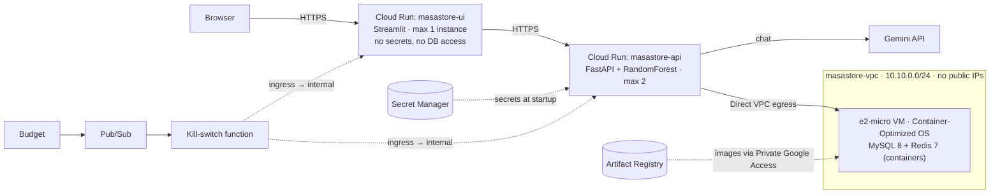

# MasaStore

A full-stack e-commerce application built as a final project for the Practical Programming course. It demonstrates a layered FastAPI backend, a Streamlit frontend, MySQL + Redis infrastructure, a Gemini-powered chat assistant, and a RandomForest product recommender as the ML bonus.

The app is deployed on Google Cloud (serverless Cloud Run + a private data VM) and also runs locally exactly as described in [Setup](#setup).

## Live demo

| | |
|---|---|
| **Website** | <https://masastore-ui-712955134267.us-central1.run.app> |
| **API docs (Swagger)** | <https://masastore-api-712955134267.us-central1.run.app/docs> |
| **Demo login** | `yossi_active` / `Password123` (see [Demo accounts](#demo-accounts)) |

> The services scale to zero when idle, so the first visit can take 10–20 seconds to wake up.

---

## Tech stack

| Layer | Technology |
|---|---|
| Backend | Python 3.11, FastAPI, Pydantic v1, `databases` (async MySQL) |
| Datastore | MySQL 8 (catalog, users, orders), Redis 7 (cache + chat counters) |
| Auth | JWT (HS256, `python-jose`), bcrypt password hashing |
| Frontend | Streamlit (multipage) |
| AI / chat | Google Gemini (`gemini-3.5-flash-lite`) through its OpenAI-compatible API, using the `openai` Python SDK |
| ML bonus | scikit-learn `RandomForestClassifier`, trained in Google Colab, exported via `joblib` |
| Infra (local) | Docker Compose (MySQL + Redis) |
| Cloud | Google Cloud: Cloud Run, Compute Engine (e2-micro), VPC, Secret Manager, Artifact Registry, Cloud Build, Pub/Sub + Cloud Functions (budget kill switch) |

---

## Features

- **User accounts** — register, login, JWT-protected endpoints, cascading delete
- **Catalog browsing** — public list/detail, multi-keyword search, price/stock filters
- **Favorites** — per-user, unique (user, item)
- **Cart and purchase** — single TEMP order per user, atomic stock decrement on purchase
- **Chat assistant** — context-aware, 5-prompt session limit (resettable)
- **ML recommendations** — RandomForest predicts next-purchase rankings; surfaced as a "✨ For You" sort on the main page
- **Caching** — Redis for catalog and per-user recommendations, invalidated on writes

---

## Architecture

Strict MVC separation:

```
Controller (HTTP)  →  Service (business logic)  →  Repository (SQL / Redis)
```

- Controllers contain no SQL and no business logic — only routing and dependency injection.
- Services hold all business rules (stock validation, JWT issue, LLM calls, ML feature extraction).
- Repositories own every SQL statement and Redis call.

The frontend never touches the database directly — it talks to FastAPI over HTTP via `ui/api_client.py`.

---

## Setup

### Prerequisites

- Python 3.11
- Docker Desktop (for MySQL + Redis)
- A Gemini API key from Google AI Studio (for the chat feature; the rest of the app works without it)

### 1. Clone and create a virtual environment

```bash
git clone <repo-url>
cd MasaStore_web
python -m venv .venv
.venv\Scripts\activate         # Windows
# source .venv/bin/activate    # macOS / Linux
pip install -r requirements.txt
```

### 2. Configure environment

Set your Gemini key either via a `.env` file at the project root (auto-loaded by Pydantic Settings; copy `.env.example` as a starting point) or as a shell variable:

```env
# .env
GEMINI_API_KEY=your-gemini-api-key-here
```

```powershell
# PowerShell alternative
$env:GEMINI_API_KEY = "your-gemini-api-key-here"
```

The chat calls Gemini through its OpenAI-compatible endpoint with the `openai` SDK; the endpoint and model are `GEMINI_BASE_URL` and `GEMINI_MODEL` in `config/config.py`.

All other settings (DB URL, Redis host, JWT secret) have sensible defaults in `config/config.py`. A real shell variable overrides the `.env`.

### 3. Start MySQL and Redis

```bash
docker-compose up -d
```

The MySQL container auto-runs `resources/db-migrations/init.sql` on first start, creating the schema and seeding 30 catalog items + 3 demo users.

> **Re-seeding:** if you change `init.sql`, run `docker-compose down -v && docker-compose up -d` — the `-v` wipes the volume so the migration re-runs.

### 4. Run the backend

```bash
uvicorn main:app --reload
```

- Swagger UI: <http://localhost:8000/docs>
- ReDoc: <http://localhost:8000/redoc>

### 5. Run the Streamlit frontend (in a separate terminal)

```bash
streamlit run ui/Main.py
```

The UI opens at <http://localhost:8501>.

### Demo accounts

| Username | Password | Persona |
|---|---|---|
| `yossi_active` | `Password123` | Tech enthusiast |
| `sara_active` | `Password123` | Home / Kitchen |

---

## API endpoints

| Method | Path | Auth | Purpose |
|---|---|---|---|
| POST | `/user/` | — | Register |
| GET | `/user/{user_id}` | JWT | Get profile |
| DELETE | `/user/{user_id}` | JWT | Delete (cascades favorites/orders) |
| POST | `/auth/token` | — | Login → JWT |
| GET | `/item/` | — | List all (Redis-cached) |
| GET | `/item/{id}` | — | Get one |
| GET | `/item/search/` | — | Multi-keyword + price/stock filters |
| GET | `/favorite/user/{user_id}` | JWT | List user's favorites |
| POST | `/favorite/` | JWT | Add favorite |
| DELETE | `/favorite/{favorite_id}` | JWT | Remove favorite |
| GET | `/order/user/{user_id}` | JWT | List orders (TEMP first) |
| GET | `/order/{order_id}` | JWT | Get one order |
| POST | `/order/item/` | JWT | Add item to cart |
| PUT | `/order/item/` | JWT | Update cart item quantity |
| DELETE | `/order/item/{order_id}/{item_id}` | JWT | Remove item from cart |
| POST | `/order/{order_id}/purchase` | JWT | Atomic stock decrement + close order |
| DELETE | `/order/{order_id}` | JWT | Delete order |
| POST | `/chat/` | JWT | Send chat message (5/session limit) |
| POST | `/chat/reset/` | JWT | Reset chat counter |
| GET | `/recommendation/` | JWT | All 30 items ranked by predicted purchase likelihood |

---

## ML bonus — Next-item recommendation

### Pipeline

1. **Synthetic data** — 5,000 users, each assigned both a category persona (Tech Enthusiast, Home Cook, Fashion Lover, Fitness Fan, Generalist) and a spending persona (Saver, Average, Spender). The spending persona weights items inside a category by `1 / price^alpha`, giving the model intra-category signal. A 35% repeat-purchase bias creates a strong "habit" signal in `purchase_hist`.
2. **Features** per user:
   - Country one-hot (10)
   - Engagement stats: order count, avg basket size, total spent, days since last order (4)
   - Per-item purchase histogram — counts distinct orders containing each item, not summed quantity (30)
   - Favorites binary vector (30)
   - Current TEMP cart binary vector (30)
3. **Label** — leave-one-out: each user's most recent purchase is the target
4. **Model** — `RandomForestClassifier(n_estimators=100, random_state=101, n_jobs=-1)` in a sklearn `Pipeline`
5. **Export** — single `recommender.joblib` bundle containing the fitted pipeline + catalog metadata + countries + version

### Why RandomForest, not Keras?

The notebook originally used a Keras ANN via `scikeras.KerasClassifier`, but scikit-learn 1.6+ broke compatibility with scikeras (`AttributeError: 'super' object has no attribute '__sklearn_tags__'`). Switching to RandomForest:
- Eliminated the dependency conflict
- Removed the need for GPU/TF in production
- Gave us `feature_importances_` for free — useful for model interpretation
- Is part of the Supervised Learning material in the course

### Reported metrics on synthetic test set

| Metric | Value | Random baseline |
|---|---|---|
| Top-1 accuracy | 16.5% | 3.3% |
| Top-3 accuracy | 37.9% | 10% |
| Top-5 accuracy | 52.6% | 16.7% |

Top-1 is ~5× random and top-3 is ~3.8× random — the spending personas (Saver / Average / Spender) provide the intra-category signal. Within a category, items are weighted by `1 / price^alpha`, so a Saver-leaning user's signal points at the cheaper Tech items (Wireless Mouse, Bluetooth Speaker) rather than the expensive ones (Tablet, Laptop). The "For You" sort in the UI surfaces this category-then-price ordering directly.

### How it's wired

- `ml/notebooks/recommender.ipynb` — Colab notebook that produces `ml/recommender.joblib`
- `service/recommendation_service.py` — lazy joblib load, feature extraction from the live DB, prediction, Redis cache
- `controller/recommendation_controller.py` — `GET /recommendation/`
- `ui/Main.py` — "✨ For You" sort consumes the ranking

Cache invalidation hooks (the live state-mutating endpoints all bust the cached recommendation for the affected user):
- `favorite_service.add_favorite` / `delete_favorite`
- `order_service.add_item_to_cart` / `update_item_in_cart` / `remove_item_from_cart` / `purchase_order` / `delete_order`

---

## Deployment (Google Cloud)

The same codebase runs in the cloud with no cloud-specific branches: every cloud setting is an environment variable whose default is the local behavior.

### Architecture



### Key decisions

| Choice | Why |
|---|---|
| **Cloud Run** for the UI and the API | Serverless containers with HTTPS out of the box; scale to zero, so idle time costs nothing. One image serves both services, only the start command differs. |
| **MySQL + Redis on an e2-micro VM** | Covered by the Always Free tier; a managed database (Cloud SQL) starts at roughly $9/month. Measured memory (the model alone adds ~150 MB) ruled out running everything on one 1 GB VM. |
| **No public IP on the VM** | The database is unreachable from the internet, and an external IPv4 address would add ~$3.65/month. The VM pulls images and reads secrets through Private Google Access. |
| **Container-Optimized OS** | Docker is preinstalled, which matters on a VM with no internet access. `init.sql` is baked into the MySQL image. |
| **Direct VPC egress** | Lets the API reach the VM's private IP without a Serverless VPC connector, which runs (and bills) instances around the clock. |
| **Budget kill switch** | Budget alerts only send email. A Pub/Sub-triggered function switches both services to internal-only ingress once spend reaches the budget, so public requests stop being billed. Tested end to end with a simulated alert. |

### Security

- No secrets in code, images or git: the Gemini API key, JWT signing key, database URL and Redis/MySQL passwords live in **Secret Manager** and are injected at runtime. `.dockerignore` and `.gcloudignore` keep `.env` out of builds.
- **Least-privilege service accounts** per component: the UI has no permissions at all, the API reads only its own secrets, and the kill switch can modify only the two services.
- **Network**: MySQL and Redis accept traffic only from the private subnet; SSH only through Identity-Aware Proxy. The default network (open SSH/RDP) was removed.
- **LLM quota protection** (cloud only): on top of the 5-prompts-per-session rule, daily per-user and site-wide caps that `/chat/reset/` cannot clear, and a bounded chat history.

### Monthly cost

Estimated at **~$0.05/month**: Cloud Run, the e2-micro VM with a 10 GB standard disk, Secret Manager, Cloud Build, Pub/Sub and logging all stay within the free tier. The only charge is ~0.15 GB of image storage above the 0.5 GB free allowance. The budget is capped by the kill switch.

### Reproducing the deployment

Everything is scripted in [`deploy/deploy.sh`](deploy/deploy.sh), one subcommand per stage, so each step can be reviewed and run on its own (Git Bash, Cloud Shell, Linux or macOS, with the `gcloud` CLI authenticated and a project selected):

```bash
bash deploy/deploy.sh apis        # enable the required Google Cloud APIs
bash deploy/deploy.sh budget      # budget with email alerts (BUDGET_AMOUNT, default 5ILS)
bash deploy/deploy.sh network     # VPC, subnet, firewall rules, reserved internal IP
bash deploy/deploy.sh iam         # service accounts
bash deploy/deploy.sh secrets     # generates passwords, reads the Gemini key (GEMINI_API_KEY) from .env
bash deploy/deploy.sh registry    # Artifact Registry repo + build staging bucket
bash deploy/deploy.sh build       # Cloud Build: app, db and redis images
bash deploy/deploy.sh vm          # data VM (MySQL + Redis)
bash deploy/deploy.sh api         # FastAPI on Cloud Run
bash deploy/deploy.sh ui          # Streamlit on Cloud Run
bash deploy/deploy.sh killswitch  # Pub/Sub topic + kill-switch function linked to the budget
bash deploy/deploy.sh reopen      # restore public access after the kill switch fired
bash deploy/deploy.sh destroy     # delete everything
```

---

## Project structure

```
MasaStore_web/
├── main.py                    # FastAPI app + router registration
├── docker-compose.yaml        # MySQL + Redis (local)
├── Dockerfile                 # One image for both Cloud Run services
├── cloudbuild.yaml            # Builds the app, db and redis images
├── requirements.txt
├── README.md
├── .gitignore
├── config/
│   └── config.py              # Pydantic Settings (DB, Redis, JWT, LLM, ML path)
├── controller/                # HTTP routing only
├── service/                   # Business logic
├── repository/                # SQL + Redis
├── model/                     # Pydantic models
├── exceptions/                # HTTPException factories
├── redisClient/               # Redis client singleton
├── resources/
│   ├── db-migrations/
│   │   └── init.sql           # Schema + seed (30 items, 3 users, demo orders)
│   └── prompts/
│       └── chat_system.txt    # Chat assistant system prompt (loaded by chat_service)
├── deploy/
│   ├── deploy.sh              # Google Cloud deployment, one subcommand per stage
│   ├── vm-startup.sh          # Data VM boot script (pulls images, reads secrets)
│   ├── db/                    # MySQL image: init.sql + low-memory config
│   ├── redis/                 # Redis image mirrored to Artifact Registry
│   └── kill_switch/           # Budget-triggered function that blocks public traffic
├── ml/
│   ├── recommender.joblib     # Trained RandomForest pipeline + metadata
│   └── notebooks/
│       └── recommender.ipynb  # Training notebook (Colab-ready)
└── ui/
    ├── Main.py                # Streamlit main page (catalog + sort)
    ├── api_client.py          # HTTP wrappers (requests)
    ├── auth_widget.py         # Login / register sidebar
    └── pages/                 # Streamlit multipage
        ├── 1_Favorites.py
        ├── 2_Orders.py
        └── 3_Chat.py
```

---

## Development notes

- **Single TEMP order per user** — enforced at the service layer (`order_service._get_or_create_temp_order`), not via a DB constraint.
- **Stock decrement is atomic** — `UPDATE item SET stock = stock - :qty WHERE id = :id AND stock >= :qty`; rowcount=0 rolls back the entire purchase transaction.
- **Price snapshot** — TEMP orders display the live catalog price (each per-line total adds up to the displayed grand total). On purchase, `order_item.price` is snapshotted from `item.price` so CLOSE orders preserve the original transaction value even if the catalog changes later.
- **Catalog cache** — Redis caches the full item list; busted on purchase (stock changes).
- **Recommendation cache** — Redis caches the per-user ranking; busted on any favorite/cart/purchase mutation.
- **Chat daily caps** — `CHAT_DAILY_USER_LIMIT` / `CHAT_DAILY_GLOBAL_LIMIT` (Redis counters that `/chat/reset/` does not clear). Both default to `0` (disabled) locally and are set only in the cloud.
- **Country constraint** — `model/user_request.py` uses `Literal` for the 10 ISO codes the recommender was trained on; the UI signup form mirrors them in a `selectbox`.
